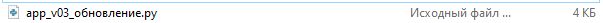
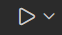
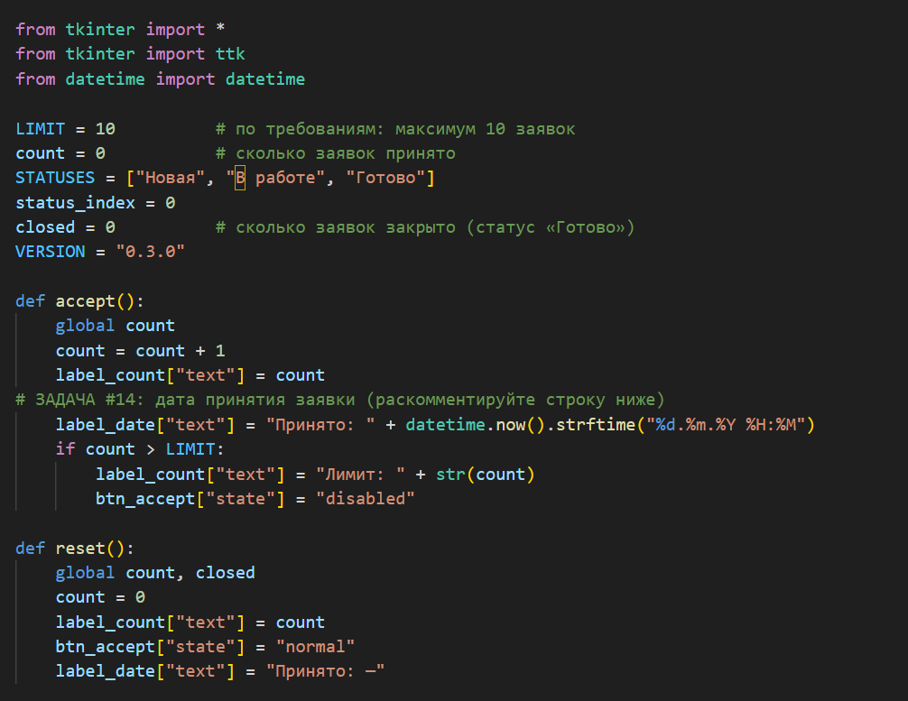
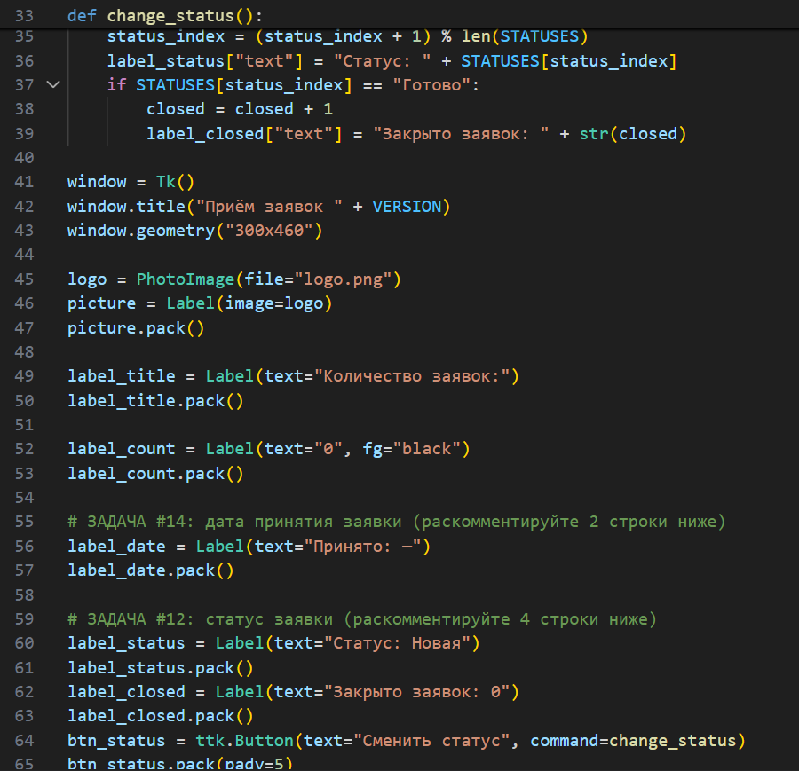
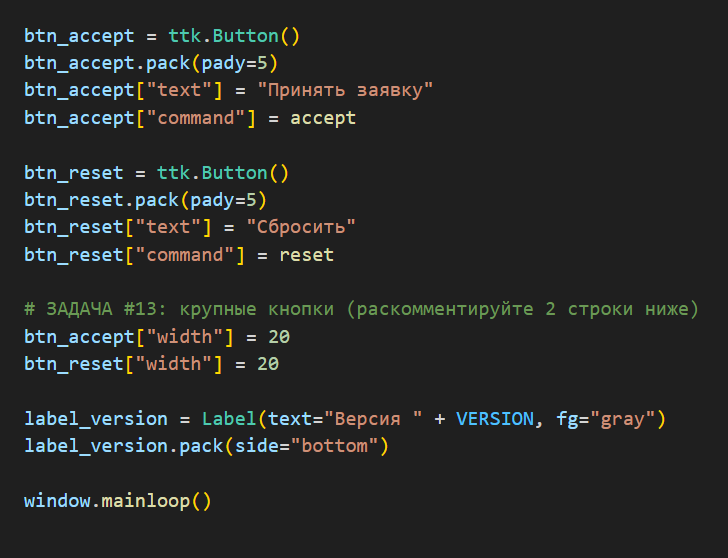

# Регрессионное тестирование: «Приём заявок» (v0.2.0)

Документация по регрессионному тестированию приложения **«Приём заявок»** версии `0.2.0`. Включает шаблон сценария на 10 шагов, образец заполненного отчёта о прогоне и пример оформления баг-репорта.

---

## 1. Исходные требования (v0.2.0)

1. Кнопка «Принять заявку» увеличивает счётчик на `1`.
2. Лимит 10 заявок: на 10-й появляется надпись «Лимит: 10», кнопка «Принять заявку» блокируется.
3. Кнопка «Сбросить» обнуляет счётчик и дату, кнопка «Принять заявку» снова работает.
4. Кнопка «Сменить статус» меняет статус по кругу: `Новая -> В работе -> Готово -> Новая`.
5. После приёма заявки показывается дата в формате `ДД.ММ.ГГГГ ЧЧ:ММ` (например, `02.11.2026 10:35`).
6. Надписи и заголовок окна без опечаток.
7. Кнопки крупные, текст читается.
8. Программа закрывается без ошибок.

---

## 2. Таблица сценария

| № | Шаг | Ожидаемо | Факт | Статус |
| :--- | :--- | :--- | :--- | :--- |
| **1** | Запустить программу и осмотреть главное окно | Заголовок окна и все надписи отображаются без опечаток. Кнопки крупные, текст хорошо читается | Заголовок и надписи без опечаток, шрифт крупный | **Сделано** |
| **2** | Нажать кнопку «Принять заявку» 1 раз | Счётчик заявок увеличивается на 1 (отображается 1) | Счётчик стал равен 1 | **Сделано** |
| **3** | Проверить поле отображения даты и времени после приёма заявки | Показывается текущая дата и время в формате `ДД.ММ.ГГГГ ЧЧ:ММ` (например, `02.11.2026 10:35`) | Отображается дата в формате `2026-11-25 11:26` (неверный формат) | **Баг** |
| **4** | Нажать кнопку «Сменить статус» 1 раз | Статус заявки меняется с «Новая» на «В работе» | Статус изменился на «В работе» | **Сделано** |
| **5** | Нажать кнопку «Сменить статус» ещё 2 раза подряд | Статус меняется по кругу: сначала на «Готово», затем возвращается в «Новая» | Статус сменился на «Готово», затем на «Новая» | **Сделано** |
| **6** | Нажать кнопку «Принять заявку» ещё 9 раз (довести счётчик до 10) | На 10-й заявке появляется надпись «Лимит: 10», кнопка «Принять заявку» становится неактивной (блокируется) | Надпись «Лимит: 10» появилась, кнопка заблокировалась | **Сделано** |
| **7** | Попытаться нажать заблокированную кнопку «Принять заявку» | Нажатие не срабатывает, счётчик остаётся равным 10 | Кнопка не нажимается, счётчик — 10 | **Сделано** |
| **8** | Нажать кнопку «Сбросить» | Счётчик заявок обнуляется, дата исчезает (обнуляется), надпись о лимите пропадает, кнопка «Принять заявку» снова активна | Счётчик обнулился, кнопка активна, но дата от прошлой заявки не очистилась | **баг** |
| **9** | Нажать кнопку «Принять заявку» после сброса | Счётчик снова увеличивается на 1 (отображается 1), появляется актуальная дата | Счётчик стал равен 1, дата обновилась | **Завершено** |
| **10** | Закрыть программу стандартным способом (крестик окна) | Программа корректно завершает работу и закрывается без ошибок | Окно закрылось без ошибок | **Сделано** |

---

## 3. Как запустить программу?
1. Сначала положите ваш файл в папку своего задания 
2. Папка задания: 
3. Далее откройте VSC и запустите программу при помощи кнопки:
4. Как выглядит программа:
5. 
6. 
7. 